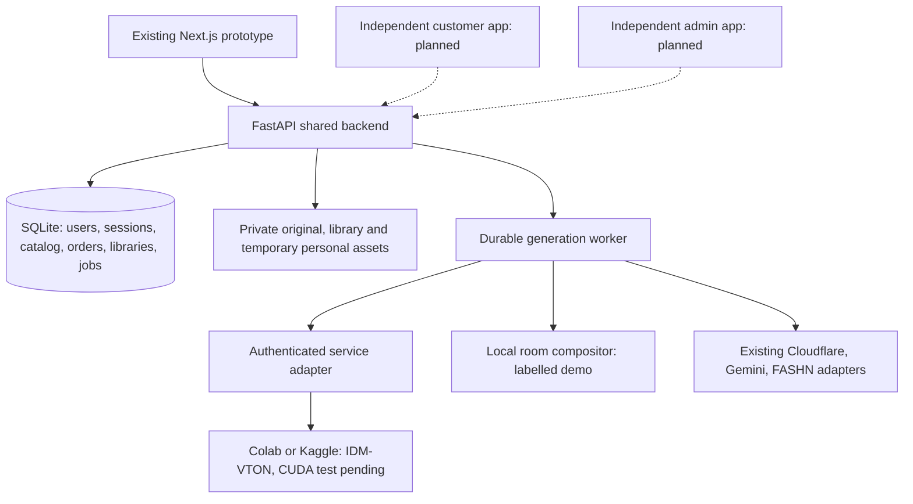

# AI-powered e-commerce platform architecture

This document separates the implemented shared backend/notebook contract from the planned independent frontends. The current local storefront and merchant prototype remain in `frontend/`. All data remains in the existing SQLite database and private file store; migration 002 adds commerce tables without replacing existing catalog revisions or assets.

## Accounts and commerce

Users store salted scrypt password hashes and customer/admin roles. Sessions store only a random cookie-token hash, CSRF token, expiry and optional user ID. Admin account sessions map to the existing merchant role so the proven catalog authorization remains in use. Account login rotates the session; logout also invalidates personal work. Origin/CSRF checks apply to the shared API, including its `/api` aliases. Future independent apps use their own same-origin API proxies; the backend does not expose a permissive CORS wildcard.

Catalog drafts and immutable publication snapshots retain JSON image metadata, with separate asset records for file provenance/ownership. Colors and creation time extend the existing product metadata. Archived products are unpublished; historical order items retain names, SKUs, options and integer prices. Orders calculate totals from published server prices inside a transaction; request keys prevent duplicate checkout. No payment gateway or inventory reservation is implemented.

## Visualization data flow

1. A customer consents and uploads their photo with a selected published product. The server selects the confirmed original product reference, never the generated catalog model as the customer's identity.
2. Upload request fingerprints map multipart retries to the same private input and durable job. Personal input/results expire after one hour and remain session-specific.
3. A merchant instead selects a reusable, permission-confirmed stock model or room template. The selected library asset is snapshotted into the generation context and becomes the actual model/background input.
4. Clothing jobs call the configured GPU provider. The notebook adapter sends person and garment in explicit order over HTTPS with Bearer authentication, a stable request ID, a 60-second timeout and one transient retry. The GPU API serializes requests and caches two output images; retained request tombstones prevent an evicted output from silently triggering another inference. Kernel restarts clear that process-local history, so interrupted/uncertain backend jobs still require review.
5. The notebook loads the official pinned IDM-VTON source/checkpoints, human parsing, OpenPose and DensePose. It uses float16 CUDA inference and adjusts mask categories for upper/lower/full garments. This is not a measured saree, identity or body-fit guarantee. Watches/shoes are unsupported by this model and use the existing reference-image editor instead.
6. Room-demo jobs use transparent/plain-background product compositing on the selected room. They do not infer physical dimensions or perform diffusion inpainting, and their output/metadata explicitly identify a placement demo.
7. Merchant results enter a draft without approval; review and publication remain explicit. AI-generated outputs are watermarked, fixtures remain labelled samples, and local composites carry a different demo label.

## Deployment boundary

Backend and current prototype bind to loopback. The GPU service also binds to its notebook's loopback address; only its authenticated inference endpoint is exposed through a user-configured ngrok tunnel after the notebook's live smoke test. Secrets remain in backend environment settings and notebook secret storage/secure prompts. Public tunnel URLs are not secret credentials; the separate Bearer token is mandatory. Do not expose the entire local FastAPI/private file store through the GPU tunnel.

The current integration is an internal educational/noncommercial demo. Upstream IDM-VTON uses CC BY-NC-SA 4.0. A public commerce deployment needs commercially appropriate model rights, reliable GPU hosting, HTTPS/cookie deployment settings, account recovery, operational monitoring and output-quality evaluation. None is implied by passing local contract tests.
